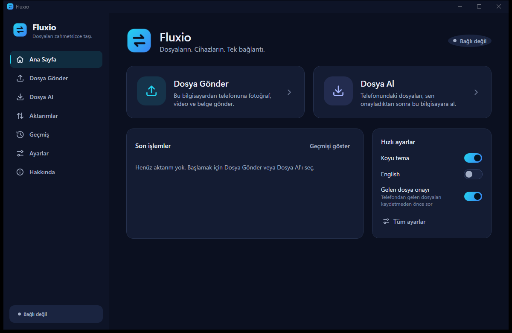

<p align="center">
  
</p>

<h1 align="center">Fluxio</h1>
<p align="center"><b>Your Files. Your Devices. One Connection.</b><br>
Transfer files between your Windows PC and your phone with a simple QR code — local network, no cable, no account, no cloud upload.</p>

> **Türkçe özet:** Fluxio, bilgisayar ile telefon arasında QR kod ile dosya aktaran açık kaynak bir uygulamadır. Windows uygulamasını aç, QR kodu telefonunun kamerasıyla tara, telefonu onayla ve dosyaları iki yönde aktar. Dosyalar yerel ağda doğrudan taşınır, SHA-256 ile doğrulanır; hesap ve bulut yoktur. Telefona uygulama kurmak gerekmez.



## What is Fluxio?

Fluxio has three parts:

| Part | Technology | What it does |
|---|---|---|
| **Windows app** (`src/Fluxio.Desktop`) | C#, .NET 10, WPF, MVVM | Choose files, show the QR code, approve phones and incoming files, follow transfers, history, settings. |
| **Transfer engine** (`src/Fluxio.Transfer`) | ASP.NET Core Kestrel | Sessions, pairing, authorization, the local HTTP API and safe file storage. Runs only while a session is open. |
| **Phone page** (`src/Fluxio.Web`) | React, TypeScript, Vite | Opens in the phone's browser after scanning the QR code. Served by the Windows app itself. |
| **Website** (`src/Fluxio.Landing`) | Static HTML/CSS/JS | Product page, download page (reads GitHub Releases), security page. Independent of the app. |

## Features

- **QR code pairing** — one-time, expiring codes (2–15 min); a new code invalidates the old one.
- **Device approval** — the same 4-digit code is shown on both screens; nothing moves before you allow the phone.
- **Two-way transfer** — computer → phone and phone → computer in one session, many files at once.
- **Approve incoming files** — with name-conflict handling: keep both, replace, or skip. Nothing is ever overwritten silently.
- **Large files** — streamed in chunks (never fully in memory); uploads resume after network drops; downloads resume with HTTP ranges.
- **Integrity** — SHA-256 on both sides; a file only counts as complete when the checksums match.
- **Real progress** — per-file and overall progress, measured speed and time remaining.
- **Drag and drop** files and folders, transfer history, Turkish and English, dark and light themes.
- **Privacy** — no account, no telemetry, local network only.

## How it works

1. Open Fluxio on your computer and choose **Send Files** or **Receive Files**.
2. Scan the QR code with your phone's camera. The Fluxio page opens in the browser; approve the phone on the computer.
3. Select files and transfer. The receiving side accepts, files stream directly between the devices and are verified.

More detail: [docs/architecture.md](docs/architecture.md).

## Installation

Releases are published on [GitHub Releases](https://github.com/efebalci569-dot/fluxio/releases) once available (installer and portable zip, with SHA-256 checksums). Builds are **not code-signed yet**, so Windows SmartScreen may warn; verify the checksum first.

- Windows 11 or Windows 10, 64-bit. .NET 10 is bundled (self-contained).
  Note: Microsoft lists only Windows 10 *Enterprise LTSC/IoT* editions as supported for .NET 10; the consumer Windows 10 22H2 is out of support. Fluxio is expected to run there but is primarily tested on Windows 11.
- Phone: Android or iPhone with an up-to-date browser. Both devices on the same Wi-Fi / local network.
- The first time Fluxio listens, Windows asks whether to allow it — allow **private** networks.

## Development

Requirements: .NET 10 SDK, Node.js 20+, Windows (for the desktop app).

```powershell
git clone https://github.com/efebalci569-dot/fluxio.git
cd fluxio
cd src/Fluxio.Web; npm ci; npm run build; cd ../..   # phone page (embedded into the engine)
dotnet test Fluxio.sln                                # 119 engine and security tests
dotnet run --project src/Fluxio.Desktop               # the Windows app
```

The engine builds the phone page automatically when `src/Fluxio.Web/dist` is missing. See [docs/development.md](docs/development.md) for the web dev server, the website preview and tests.

## Security model

Fluxio does not trust every device on the local network. In short: random 256-bit one-time pairing secret in the QR code (in the URL fragment), explicit device approval, bearer tokens in headers (no cookies → no CSRF), Host/Origin checks against DNS rebinding and cross-site requests, the service listens on one LAN address and only during a session, file names are sanitized and writes are confined to the chosen folder, data is verified before it gets its real name, received files are never opened and get the Mark of the Web.

Full details, including what is **not** protected: [docs/security.md](docs/security.md). API: [docs/api.md](docs/api.md).

## Known limitations

- Both devices must be on the same local network. Transfers over the internet are not available yet.
- The connection inside the network uses **HTTP** (Wi-Fi encryption protects it over the air). A trusted HTTPS connection to a local IP would require installing certificates on the phone; Fluxio does not ask users to click through certificate warnings. Use Fluxio on networks you trust.
- Mobile browsers decide where downloads are saved. Downloads larger than 1 GB (512 MB on iPhone) use the browser's download manager and cannot be verified by the page.
- Transfers stop if the phone locks the screen or the browser goes to the background (browsers suspend pages).
- If an upload is interrupted by reloading the phone page, the files must be selected again.
- Guest networks / routers with “client isolation” block phone ↔ PC traffic.
- Not code-signed yet.

## Contributing

Issues and pull requests are welcome.

1. Fork and create a branch.
2. Keep changes focused; add or update tests (`tests/`, `src/Fluxio.Web/src/**/*.test.ts`).
3. Run `dotnet test Fluxio.sln` and `npm test` in `src/Fluxio.Web` before opening a pull request.
4. All user-visible text goes through the localization files (`src/Fluxio.Desktop/Resources/Strings/*.json`, `src/Fluxio.Web/src/i18n/strings.ts`).

Please report security problems privately (GitHub → Security → Report a vulnerability), not in public issues.

## License

[MIT](LICENSE) © 2026 Fluxio contributors. Third-party components: QRCoder (MIT), CommunityToolkit.Mvvm (MIT), Microsoft.Data.Sqlite (MIT) / SQLite (public domain), ASP.NET Core (MIT), React (MIT), @noble/hashes (MIT).
